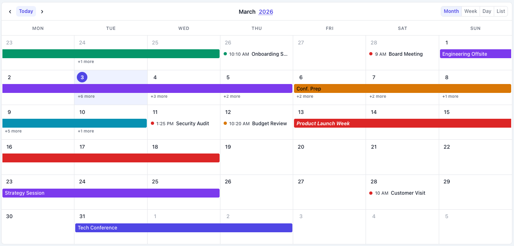
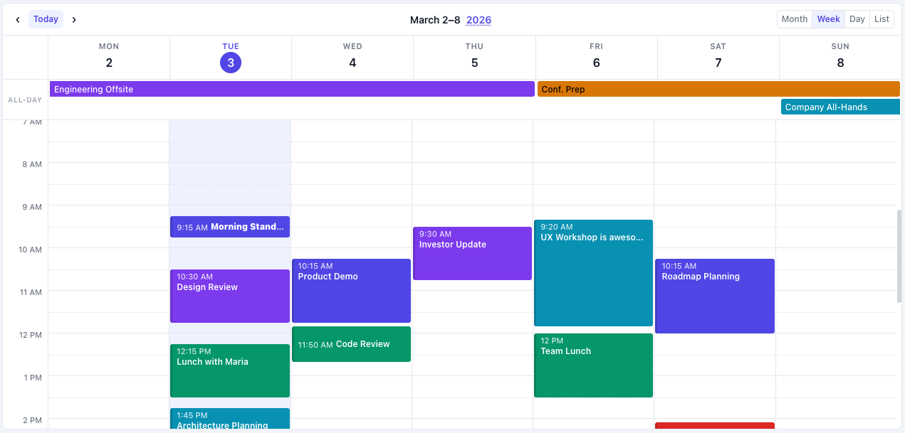
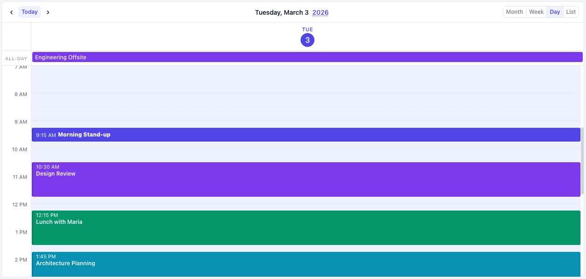
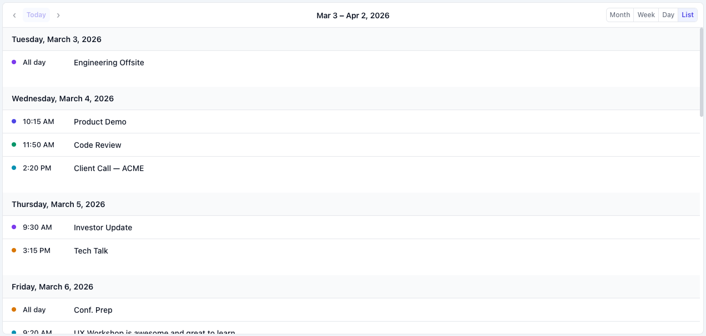
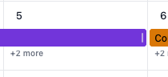
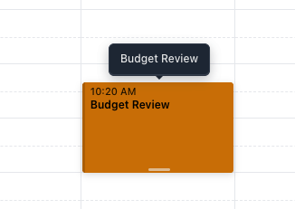

# SimpleCalendarJs

A lightweight, zero-dependency JavaScript calendar component with internationalization support and framework wrappers for React, Vue, and Angular.

[](https://www.npmjs.com/package/simple-calendar-js)
[](https://unpkg.com/simple-calendar-js/LICENSE)

## Features

- **Zero Dependencies** - Pure vanilla JavaScript, no external libraries
- **Four View Modes** - Month, week, day, and list views with smooth transitions
- **Full Internationalization** - Built on Intl.DateTimeFormat API for native locale support
- **Framework Wrappers** - Official React, Vue 3, and Angular components included
- **Module System Support** - Works as UMD (CommonJS, AMD, ES modules, or browser global)
- **Dark Mode Ready** - Automatic dark theme detection and support
- **Async Event Loading** - Fetch events dynamically with `async/await` support
- **Responsive Design** - Adapts to any screen size
- **Customizable Styling** - CSS custom properties for easy theming
- **Accessible** - Semantic HTML with proper ARIA attributes
- **Small Bundle Size** - ~45KB minified JS + ~22KB CSS (~16KB total gzipped)

## Screenshots

### Four View Modes

<table>
  <tr>
    <td width="50%">
      
      <p align="center"><strong>Month View</strong></p>
    </td>
    <td width="50%">
      
      <p align="center"><strong>Week View</strong></p>
    </td>
  </tr>
  <tr>
    <td width="50%">
      
      <p align="center"><strong>Day View</strong></p>
    </td>
    <td width="50%">
      
      <p align="center"><strong>List View</strong></p>
    </td>
  </tr>
</table>

### Drag & Drop / Resize Events

<table>
  <tr>
    <td width="50%">
      
      <p align="center"><strong>Drag & Drop Events</strong></p>
    </td>
    <td width="50%">
      
      <p align="center"><strong>Resize Events</strong></p>
    </td>
  </tr>
</table>

## Installation

### NPM

```bash
npm install simple-calendar-js
```

### CDN

```html
<link rel="stylesheet" href="https://unpkg.com/simple-calendar-js/dist/simple-calendar-js.min.css">
<script src="https://unpkg.com/simple-calendar-js/dist/simple-calendar-js.min.js"></script>
```

### Manual Download

Download the files from the [dist/](dist/) folder and include them in your project.

## Quick Start

### Vanilla JavaScript

```html
<!DOCTYPE html>
<html>
<head>
  <link rel="stylesheet" href="simple-calendar-js.css">
</head>
<body>
  <div id="calendar"></div>

  <script src="simple-calendar-js.js"></script>
  <script>
    const calendar = new SimpleCalendarJs('#calendar', {
      defaultView: 'month',
      locale: 'en-US',
      fetchEvents: async (startDate, endDate) => {
        // Fetch events from your API
        const response = await fetch(`/api/events?start=${startDate}&end=${endDate}`);
        return await response.json();
      },
      onEventClick: (event, mouseEvent) => {
        console.log('Event clicked:', event);
      }
    });
  </script>
</body>
</html>
```

### React

```jsx
import SimpleCalendarJsReact from 'simple-calendar-js/frameworks/simple-calendar-js-react.jsx';
import 'simple-calendar-js/dist/simple-calendar-js.min.css';

function MyCalendar() {
  const fetchEvents = async (startDate, endDate) => {
    const res = await fetch(`/api/events?start=${startDate}&end=${endDate}`);
    return await res.json();
  };

  return (
    <SimpleCalendarJsReact
      defaultView="month"
      locale="en-US"
      fetchEvents={fetchEvents}
      onEventClick={(event) => console.log(event)}
      style={{ height: '600px' }}
    />
  );
}
```

### Vue 3

```vue
<template>
  <SimpleCalendarJsVue
    :defaultView="'month'"
    :locale="'en-US'"
    :fetchEvents="fetchEvents"
    @eventClick="handleEventClick"
    :style="{ height: '600px' }"
  />
</template>

<script>
import SimpleCalendarJsVue from 'simple-calendar-js/frameworks/simple-calendar-js-vue.js';
import 'simple-calendar-js/dist/simple-calendar-js.min.css';

export default {
  components: { SimpleCalendarJsVue },
  methods: {
    async fetchEvents(startDate, endDate) {
      const res = await fetch(`/api/events?start=${startDate}&end=${endDate}`);
      return await res.json();
    },
    handleEventClick(event) {
      console.log('Event clicked:', event);
    }
  }
}
</script>
```

### Angular

```typescript
import { Component } from '@angular/core';

@Component({
  selector: 'app-calendar',
  template: `
    <simple-calendar-js
      [defaultView]="'month'"
      [locale]="'en-US'"
      [fetchEvents]="fetchEvents"
      (eventClick)="handleEventClick($event)"
      [style.height.px]="600"
    ></simple-calendar-js>
  `
})
export class CalendarComponent {
  async fetchEvents(startDate: Date, endDate: Date) {
    const res = await fetch(`/api/events?start=${startDate}&end=${endDate}`);
    return await res.json();
  }

  handleEventClick(event: any) {
    console.log('Event clicked:', event);
  }
}
```

## Configuration Options

| Option | Type | Default | Description |
|--------|------|---------|-------------|
| `defaultView` | string | `'month'` | Initial view: `'month'`, `'week'`, `'day'`, or `'list'` |
| `defaultDate` | Date | `new Date()` | Initial date to display |
| `weekStartsOn` | number | `0` | First day of week: `0` (Sunday) or `1` (Monday) |
| `locale` | string | `'default'` | Locale code for Intl API (e.g., `'en-US'`, `'fr-FR'`, `'ja-JP'`) |
| `weekdayFormat` | string | `'short'` | Weekday name format: `'narrow'` (1-2 letters), `'short'` (abbreviated), or `'long'` (full name) |
| `use24Hour` | boolean | `false` | Use 24-hour time format |
| `showTimeInItems` | boolean | `true` | Show time in event items |
| `showGridLines` | boolean | `true` | Show calendar grid lines |
| `showBorder` | boolean | `true` | Show calendar outer border |
| `showToolbar` | boolean | `true` | Show the toolbar |
| `showTodayButton` | boolean | `true` | Show "Today" button |
| `showNavigation` | boolean | `true` | Show prev/next navigation arrows |
| `showTitle` | boolean | `true` | Show month/year title |
| `showYearPicker` | boolean | `true` | Enable year picker dropdown (month view) |
| `showViewSwitcher` | boolean | `true` | Show view switcher buttons |
| `showTooltips` | boolean | `true` | Show tooltips on hover for events |
| `listDaysForward` | number | `30` | Number of days forward to show in list view |
| `enabledViews` | string[] | `['month', 'week', 'day']` | Available view modes. Add `'list'` to enable list view |
| `enableDragDrop` | boolean | `false` | Enable drag and drop to move events |
| `enableResize` | boolean | `false` | Enable resizing events to change duration |
| `autoContrastText` | boolean | `false` | Automatically calculate contrasting text color based on event background color for better readability |
| `contrastLevel` | string | `'high'` | Text contrast level when `autoContrastText` is enabled: `'high'` (black/white), `'medium'` (darker/lighter shade), `'low'` (subtle variation) |
| `allowHtmlInEvents` | boolean | `false` | Allow basic HTML tags in event titles (sanitized for security). Supports: `<b>`, `<i>`, `<strong>`, `<em>`, `<span>`, `<br>` with `class` attribute for icons |
| `monthTimedEventStyle` | string | `'list'` | Display style for timed events in month view: `'list'` (schedule format) or `'block'` (traditional blocks) |
| `monthDayNumberAlign` | string | `'left'` | Horizontal alignment of day numbers in month view cells: `'left'`, `'center'`, or `'right'` |
| `showEventBorder` | boolean | `false` | Display borders around events. Border color adaptively darkens from event background (light colors darken more for visibility), or use event's `borderColor` property |
| `fetchEvents` | function | `null` | Async function to fetch events: `async (start, end) => Event[]` |
| `onEventClick` | function | `null` | Callback when event is clicked: `(event, mouseEvent) => void` |
| `onSlotClick` | function | `null` | Callback when time slot is clicked: `(date, mouseEvent) => void` |
| `onViewChange` | function | `null` | Callback when view changes: `(view) => void` |
| `onNavigate` | function | `null` | Callback when date range changes: `(startDate, endDate) => void` |
| `onEventDrop` | function | `null` | Callback when event is dropped: `(event, oldStart, oldEnd, newStart, newEnd) => void` |

## Event Object Format

Events returned by `fetchEvents` should follow this structure:

```typescript
interface CalendarEvent {
  id: string | number;           // Unique identifier
  title: string;                 // Event title (can contain HTML if allowHtmlInEvents is enabled)
  start: Date;                   // Start date/time
  end?: Date;                    // End date/time (optional, defaults to start)
  allDay?: boolean;              // All-day event flag (optional)
  color?: string;                // Custom background color (hex, optional)
  textColor?: string;            // Custom text color (hex, optional) - overrides autoContrastText
  allowHtml?: boolean;           // Override global allowHtmlInEvents setting for this event (optional)
  description?: string;          // Event description (also used for tooltip if tooltip not provided)
  tooltip?: string;              // Custom tooltip text shown on hover (overrides description)
  [key: string]: any;            // Any additional custom properties
}
```

### Example Events

```javascript
const events = [
  {
    id: 1,
    title: 'Team Meeting',
    start: new Date('2024-03-15T10:00:00'),
    end: new Date('2024-03-15T11:00:00'),
    color: '#3b82f6',
    tooltip: 'Weekly team sync\nDiscuss Q1 roadmap and sprint planning'
  },
  {
    id: 2,
    title: 'Conference',
    start: new Date('2024-03-20T00:00:00'),
    end: new Date('2024-03-22T23:59:59'),
    allDay: true,
    color: '#10b981',
    description: 'Tech Conference 2024\nDowntown Convention Center'
  }
];
```

## Timezone Handling

SimpleCalendarJs relies on JavaScript's native Date object for timezone handling, which means events are automatically displayed in the **user's local timezone**.

### How It Works

1. **Automatic Conversion**: JavaScript Date objects automatically convert to the user's browser timezone
2. **No Configuration Needed**: The calendar has no timezone settings - it uses the browser's timezone
3. **Backend Responsibility**: Your backend should send timezone-aware date strings

### Best Practices

**✓ Recommended - Send ISO 8601 strings with timezone:**

```javascript
fetchEvents: async (start, end) => {
  const response = await fetch(`/api/events?start=${start}&end=${end}`);
  const events = await response.json();

  // Backend returns ISO 8601 strings with timezone info
  // Example: "2024-03-15T10:00:00Z" (UTC)
  // or: "2024-03-15T10:00:00-05:00" (EST)

  return events.map(event => ({
    ...event,
    start: new Date(event.start), // Automatically converts to local timezone
    end: new Date(event.end)
  }));
}
```

**✗ Avoid - Sending dates without timezone info:**

```javascript
// BAD: "2024-03-15T10:00:00" (no timezone)
// JavaScript interprets this as LOCAL time, not UTC
// This can cause issues for users in different timezones
```

### Example: Multi-Timezone Scenario

**Scenario**: Your server stores events in UTC, users are in different timezones

```javascript
// Server returns (stored in UTC):
{
  "title": "Team Meeting",
  "start": "2024-03-15T14:00:00Z",  // 2:00 PM UTC
  "end": "2024-03-15T15:00:00Z"     // 3:00 PM UTC
}

// User in New York (EST, UTC-5):
// Calendar displays: 9:00 AM - 10:00 AM

// User in London (GMT, UTC+0):
// Calendar displays: 2:00 PM - 3:00 PM

// User in Tokyo (JST, UTC+9):
// Calendar displays: 11:00 PM - 12:00 AM
```

### Important Notes

- **Storage**: Always store events in UTC in your database
- **API Format**: Send dates as ISO 8601 strings with timezone information
- **Display**: The calendar automatically shows events in the user's local timezone
- **No Timezone Selector**: The calendar doesn't provide UI to change timezone - it always uses the browser's timezone
- **Time Formatting**: Uses `Intl.DateTimeFormat` which respects the user's locale and timezone

### Example Backend Response

```json
{
  "events": [
    {
      "id": 1,
      "title": "Global Team Standup",
      "start": "2024-03-15T14:00:00Z",
      "end": "2024-03-15T14:30:00Z",
      "description": "Daily standup - all timezones welcome"
    }
  ]
}
```

## Tooltips

SimpleCalendarJs includes built-in tooltip support for displaying additional event information on hover.

### How Tooltips Work

Tooltips appear when you hover over an event for 400ms. They display content based on the following priority:

1. **`tooltip` property** (highest priority) - Custom tooltip text
2. **`description` property** - Falls back if no tooltip is provided
3. **`title` property** - Falls back if neither tooltip nor description is provided

### Basic Usage

```javascript
const events = [
  {
    id: 1,
    title: 'Team Meeting',
    start: new Date('2024-03-15T10:00:00'),
    end: new Date('2024-03-15T11:00:00'),
    tooltip: 'Weekly team sync\nDiscuss Q1 roadmap'  // Custom tooltip
  },
  {
    id: 2,
    title: 'Client Call',
    start: new Date('2024-03-15T14:00:00'),
    end: new Date('2024-03-15T15:00:00'),
    description: 'Requirements gathering\nPrepare demo'  // Used as tooltip
  },
  {
    id: 3,
    title: 'Code Review',
    start: new Date('2024-03-15T16:00:00'),
    end: new Date('2024-03-15T17:00:00')
    // No tooltip/description - will show title
  }
];
```

### Multiline Tooltips

Use `\n` (newline character) in your tooltip or description text to create multiple lines:

```javascript
{
  id: 1,
  title: 'Project Kickoff',
  start: new Date('2024-03-20T09:00:00'),
  end: new Date('2024-03-20T10:30:00'),
  tooltip: 'Project Kickoff Meeting\n\nAgenda:\n- Introductions\n- Timeline review\n- Q&A session\n\nLocation: Conference Room A'
}
```

### Tooltip Features

- **Smart Positioning**: Tooltips automatically adjust their position to stay visible:
  - Events near the **top** of the viewport: tooltip shows below
  - Events near the **right edge**: tooltip aligns to the right
  - Events near the **left edge**: tooltip aligns to the left

- **Visual Design**:
  - Dark background with rounded corners
  - Small arrow pointing to the event
  - Smooth fade-in animation (400ms delay)
  - Supports both light and dark themes

- **Responsive**: Tooltips overflow outside calendar boundaries to ensure full visibility

### Disabling Tooltips

You can disable tooltips globally using the `showTooltips` option:

```javascript
const calendar = new SimpleCalendarJs('#calendar', {
  showTooltips: false,  // Disable all tooltips
  fetchEvents: async (start, end) => { ... }
});
```

### Styling Tooltips

Tooltips use CSS custom properties and can be customized:

```css
:root {
  --cal-tooltip-bg: #1f2937;           /* Background color */
  --cal-tooltip-text: #f9fafb;         /* Text color */
  --cal-tooltip-border: #374151;       /* Border color */
  --cal-tooltip-max-width: 250px;      /* Maximum width */
  --cal-tooltip-padding: 8px 12px;     /* Inner padding */
  --cal-tooltip-radius: 6px;           /* Border radius */
  --cal-tooltip-font-size: 12px;       /* Font size */
  --cal-tooltip-offset: 8px;           /* Distance from event */
}
```

### Limitations

- Tooltips display **plain text only** (no HTML rendering)
- Special characters are automatically escaped for security
- Maximum width is 250px by default (can be customized via CSS variables)

## Drag and Drop

SimpleCalendarJs supports drag and drop for moving events and resizing them to change their duration.

### Configuration

```javascript
const calendar = new SimpleCalendarJs('#calendar', {
  enableDragDrop: true,  // Enable moving events
  enableResize: true,     // Enable resizing events

  onEventDrop: (event, oldStart, oldEnd, newStart, newEnd) => {
    // Detect if this is a move or resize
    const isMoved = oldStart.getTime() !== newStart.getTime();
    const isResized = oldEnd.getTime() !== newEnd.getTime() && !isMoved;

    if (isMoved) {
      console.log(`Event "${event.title}" moved to ${newStart}`);
    } else if (isResized) {
      console.log(`Event "${event.title}" resized to end at ${newEnd}`);
    }

    // Update your backend
    await fetch(`/api/events/${event.id}`, {
      method: 'PATCH',
      headers: { 'Content-Type': 'application/json' },
      body: JSON.stringify({
        start: newStart.toISOString(),
        end: newEnd.toISOString(),
        allDay: event.allDay
      })
    });
  }
});
```

### Moving Events (`enableDragDrop`)

**How It Works:**
- **Drag Initiation**: Click and hold on an event, then move at least 5px or wait 150ms
- **Visual Feedback**: The event follows your cursor while dragging
- **Snap to Grid**: Events snap to 15-minute intervals in week/day views
- **Drop**: Release to drop the event at the new date/time
- **Cancel**: Press ESC to cancel the drag operation
- **Duration Preservation**: Events maintain their duration when moved
- **Touch Support**: Full support for mobile/tablet touch gestures

**Cross-Boundary Conversion:**

When dragging events between different sections:

**Timed Event → All-Day Section (Week/Day Views):**
- Converts to an all-day event
- Preserves the day span

**All-Day Event → Timed Section (Week/Day Views):**
- Converts to a timed event
- Default duration: 1 hour
- Snaps to the time slot where dropped

**Month View:**
- Events maintain their original type (all-day stays all-day, timed stays timed)
- Timed events preserve their original time of day

### Resizing Events (`enableResize`)

**Horizontal Resize (All-Day Events):**
- **Visual Indicator**: Small vertical line appears on the right edge when hovering
- **How It Works**: Drag the right edge to change the number of days the event spans
- **Available In**: Month view, week/day all-day sections
- **Minimum**: 1 day

**Vertical Resize (Timed Events):**
- **Visual Indicator**: Small horizontal line appears at the bottom when hovering
- **How It Works**: Drag the bottom edge to change the end time
- **Available In**: Week/day timed sections
- **Snap to Grid**: 15-minute intervals
- **Minimum**: 15 minutes
- **Live Feedback**: Time display updates to show start and end times as you drag

### Callback Parameters

The `onEventDrop` callback receives the same parameters for both move and resize operations:

| Parameter | Type | Description |
|-----------|------|-------------|
| `event` | Object | The updated event object (with new start/end) |
| `oldStart` | Date | Original start date/time |
| `oldEnd` | Date | Original end date/time |
| `newStart` | Date | New start date/time |
| `newEnd` | Date | New end date/time |

**Detecting Operation Type:**
- **Move**: `oldStart !== newStart`
- **Resize**: `oldStart === newStart` and `oldEnd !== newEnd`

### Important Notes

- The calendar updates the event internally before firing the callback
- You **must** update your backend in the `onEventDrop` callback
- If the backend update fails, call `calendar.refresh()` to revert to the previous state
- Both features are disabled in list view (read-only)
- You can enable one, both, or neither feature independently

## Month View Timed Event Display Style

The `monthTimedEventStyle` option controls how timed events are displayed in month view:

### List Style (Default: `'list'`)
Schedule-style display with horizontal layout:
- **Colored dot**: Shows event color as a small circle
- **Time**: Displays start time (if `showTimeInItems` is enabled)
- **Title**: Event title truncated with ellipsis if too long
- **Compact**: Clean, minimal appearance similar to schedule apps

```javascript
const calendar = new SimpleCalendarJs('#calendar', {
  monthTimedEventStyle: 'list',  // Default
  showTimeInItems: true           // Shows time next to dot
});
```

### Block Style (`'block'`)
Traditional calendar block display:
- **Colored Background**: Full event background in event color
- **Time Display**: Start time shown inside block (if enabled)
- **Classic Look**: Traditional calendar appearance

```javascript
const calendar = new SimpleCalendarJs('#calendar', {
  monthTimedEventStyle: 'block'
});
```

**Note**: This option only affects timed events in month view. All-day events always display as blocks, and week/day views always use block style with duration-based heights.

## Month View Row Heights

Month view automatically adapts row heights based on your container's height and event content:

### Fixed Height Container
When you set an explicit height on the calendar container (e.g., `height: 600px`), the calendar calculates the maximum number of events that can fit in each cell and displays a "+N more" indicator for overflow events.

```javascript
// HTML with fixed height
<div id="calendar" style="height: 600px;"></div>

// Calendar automatically limits events to fit the available space
const calendar = new SimpleCalendarJs('#calendar', {
  defaultView: 'month'
});
```

### Natural Height Container (Auto/Unlimited Mode)
When the container has no explicit height (or `height: auto`), the calendar displays **all events** with **variable row heights**:

- **Rows with many events** → Automatically expand to fit all events
- **Rows with few events** → Use minimal vertical space
- **Empty rows** → Collapse to minimum height (80px)
- **Each row is independent** → Heights calculated individually per row

```javascript
// HTML with natural height
<div id="calendar" style="height: auto;"></div>

// or
<div id="calendar"></div>

// All events displayed, rows adapt to content
const calendar = new SimpleCalendarJs('#calendar', {
  defaultView: 'month'
});
```

### Benefits of Variable Row Heights
- **Eliminates wasted space**: Empty rows don't take up unnecessary vertical space
- **Optimal density**: Each week row is exactly as tall as it needs to be
- **No uniform padding**: Weeks with 20 events don't force empty weeks to be equally tall
- **Better UX**: Users see all events without clicking "+N more" when there's room

**Recommendation**: Use fixed height containers when you need predictable layouts, and natural height when you want to show all events with minimal scrolling.

## Auto-Contrast Text Color

SimpleCalendarJs can automatically calculate the best text color for event text based on the background color, ensuring optimal readability with configurable contrast levels.

### Contrast Levels

Choose from three contrast levels to match your design preferences:

#### High Contrast (default: `'high'`)
Pure black or white text for maximum readability:
- **Light backgrounds** (luminance > 0.5) → Black text (#000000)
- **Dark backgrounds** (luminance ≤ 0.5) → White text (#ffffff)

#### Medium Contrast (`'medium'`)
Darker or lighter shade of the background color for a more integrated look:
- **Light backgrounds** → Darkened version of the background color
- **Dark backgrounds** → Lightened version of the background color

#### Low Contrast (`'low'`)
Subtle variation that maintains the color family:
- **Light backgrounds** → Slightly darker shade
- **Dark backgrounds** → Slightly lighter shade

### Basic Usage

```javascript
const calendar = new SimpleCalendarJs('#calendar', {
  autoContrastText: true,     // Enable automatic text color calculation
  contrastLevel: 'medium',    // Choose contrast level: 'high', 'medium', or 'low'
  fetchEvents: async (start, end) => {
    return [
      {
        id: 1,
        title: 'Team Meeting',
        start: new Date('2024-03-15T10:00:00'),
        color: '#ffeb3b'  // Yellow background → auto-calculated dark yellow text
      },
      {
        id: 2,
        title: 'Project Review',
        start: new Date('2024-03-16T14:00:00'),
        color: '#1a237e'  // Dark blue background → auto-calculated light blue text
      }
    ];
  }
});
```

### Comparison of Contrast Levels

```javascript
// High contrast (default) - Black or white
{ color: '#4f46e5', autoContrastText: true, contrastLevel: 'high' }
// Result: White text (#ffffff)

// Medium contrast - Darker/lighter shade
{ color: '#4f46e5', autoContrastText: true, contrastLevel: 'medium' }
// Result: Light indigo text (calculated from background)

// Low contrast - Subtle variation
{ color: '#4f46e5', autoContrastText: true, contrastLevel: 'low' }
// Result: Slightly lighter indigo text
```

### Manual Override

Individual events can override the auto-calculated color with a custom `textColor`:

```javascript
{
  id: 1,
  title: 'Special Event',
  start: new Date('2024-03-15T10:00:00'),
  color: '#4caf50',      // Green background
  textColor: '#ffeb3b'   // Force yellow text (overrides auto-contrast)
}
```

### Priority Order

Text color is determined in this order:
1. **`event.textColor`** (highest priority) - Manual override
2. **`autoContrastText: true`** - Automatic calculation based on background color
3. **CSS variable** `--cal-event-text` (default) - Fallback to theme default

### When to Use

**Enable `autoContrastText` when:**
- Events have diverse background colors from user preferences or categories
- You want consistent readability without manually setting text colors
- Event colors are generated dynamically

**Disable `autoContrastText` (default) when:**
- All events use similar colors with known good contrast
- You prefer full control over text colors via CSS or event properties
- You want to maintain backward compatibility

### Browser Support

The auto-contrast calculation works in all modern browsers and has no dependencies. It handles:
- Hex colors with or without `#` prefix (#ff0000 or ff0000)
- CSS variables (falls back to theme default)
- Invalid colors (falls back to theme default)

## HTML in Event Titles

SimpleCalendarJs allows basic HTML formatting in event titles for icons, bold/italic text, and simple styling while maintaining security through automatic sanitization.

### Security & Sanitization

All HTML is automatically sanitized to prevent XSS attacks:
- **Allowed tags**: `<b>`, `<i>`, `<strong>`, `<em>`, `<span>`, `<br>`
- **Allowed attributes**: `class` (for icon libraries like Font Awesome)
- **Blocked**: `<script>`, event handlers (`onclick`, `onerror`), dangerous attributes
- **Character limit**: Class names are sanitized to alphanumeric, dash, underscore, and space only

### Basic Usage

Enable HTML globally for all events:

```javascript
const calendar = new SimpleCalendarJs('#calendar', {
  allowHtmlInEvents: true,  // Enable HTML rendering
  fetchEvents: async (start, end) => {
    return [
      {
        id: 1,
        title: '<b>Important</b> Meeting',
        start: new Date('2024-03-15T10:00:00')
      },
      {
        id: 2,
        title: 'Design <i>Review</i>',
        start: new Date('2024-03-16T14:00:00')
      }
    ];
  }
});
```

### Font Awesome Icons

Perfect for adding visual indicators:

```javascript
{
  id: 1,
  title: '<i class="fas fa-video"></i> Video Call',
  start: new Date('2024-03-15T10:00:00')
}

{
  id: 2,
  title: '<i class="fas fa-plane"></i> Flight to NYC',
  start: new Date('2024-03-16T14:00:00'),
  allDay: true
}

{
  id: 3,
  title: '<i class="fas fa-birthday-cake"></i> <b>Sarah</b> Birthday',
  start: new Date('2024-03-20T00:00:00'),
  allDay: true
}
```

### Other Icon Libraries

Works with any icon library that uses class names:

```javascript
// Material Icons
{ title: '<i class="material-icons">event</i> Meeting' }

// Bootstrap Icons
{ title: '<i class="bi bi-calendar"></i> Appointment' }

// Ionicons
{ title: '<i class="ion ion-md-call"></i> Phone Call' }
```

### Per-Event Control

Override the global setting for specific events:

```javascript
const calendar = new SimpleCalendarJs('#calendar', {
  allowHtmlInEvents: false,  // Disabled globally
  fetchEvents: async (start, end) => {
    return [
      {
        id: 1,
        title: 'Regular Meeting',  // Plain text
        start: new Date('2024-03-15T10:00:00')
      },
      {
        id: 2,
        title: '<i class="fas fa-star"></i> <b>VIP</b> Client Call',
        start: new Date('2024-03-16T14:00:00'),
        allowHtml: true  // Enable HTML only for this event
      }
    ];
  }
});
```

### Supported HTML Tags

| Tag | Purpose | Example |
|-----|---------|---------|
| `<b>`, `<strong>` | Bold text | `<b>Important</b>` |
| `<i>`, `<em>` | Italic text or icons | `<i class="fas fa-star"></i>` |
| `<span>` | Inline styling container | `<span class="custom-class">Text</span>` |
| `<br>` | Line break | `Line 1<br>Line 2` |

### Important Notes

- **Default behavior**: HTML is disabled by default (`allowHtmlInEvents: false`)
- **Security first**: All HTML is sanitized - dangerous tags and attributes are stripped
- **Class attribute only**: Only the `class` attribute is preserved (for icons)
- **No inline styles**: `style` attributes are removed for security
- **Plain text fallback**: If `allowHtmlInEvents` is false, HTML is escaped and displayed as text
- **Tooltips**: HTML is NOT rendered in tooltips (security consideration)

### Best Practices

**✓ Recommended**:
- Use for icons and simple formatting
- Keep HTML minimal and semantic
- Test with `allowHtmlInEvents: false` to ensure graceful degradation

**✗ Avoid**:
- Complex nested HTML structures
- Custom styles via `style` attribute (use `class` and external CSS)
- User-generated HTML without validation

### Example: Icon + Formatting

```javascript
const events = [
  {
    id: 1,
    title: '<i class="fas fa-users"></i> <b>Team Standup</b>',
    start: new Date('2024-03-15T09:00:00'),
    color: '#3b82f6'
  },
  {
    id: 2,
    title: '<i class="fas fa-exclamation-triangle"></i> <b>Urgent</b>: Server Down',
    start: new Date('2024-03-15T14:30:00'),
    color: '#ef4444'
  }
];

const calendar = new SimpleCalendarJs('#calendar', {
  allowHtmlInEvents: true,
  fetchEvents: async () => events
});
```

## API Methods

```javascript
// Switch view
calendar.setView('week');

// Navigate forward/backward
calendar.navigate(1);   // Next period
calendar.navigate(-1);  // Previous period

// Jump to specific date
calendar.goToDate(new Date('2024-12-25'));

// Jump to today
calendar.goToToday();

// Refresh calendar (clear cache and re-fetch events)
calendar.refresh();

// Cleanup (important for SPAs)
calendar.destroy();
```

### Event Caching

SimpleCalendarJs intelligently caches fetched events to minimize unnecessary network requests:

- **Smart fetch strategy**: Always fetches the **full month grid** (including leading/trailing days), regardless of current view
- **Automatic caching**: Events are cached by date range after each fetch
- **Efficient reuse**: View switches and navigation within the cached range use cached data (no spinner, instant display)
- **Fetch only when needed**: New data is fetched only when the required range extends beyond the cache
- **Manual refresh**: Call `calendar.refresh()` when events change externally (added, updated, or deleted)

**How it works:**
- When in **month/week/day views**: Fetches the full month grid for the current date context
- When in **list view**: Fetches the specific forward range (configurable with `listDaysForward`)
- Subsequent navigation within the same month uses cached data
- Navigation to a different month triggers a new fetch for that month's full grid

**Example behavior:**
```javascript
// Month view Feb 2026: Fetches Jan 28 - Mar 1 (full month grid)
calendar.setView('month');  // ✓ Fetch: Jan 28 - Mar 1

// Switch to week view (Feb 20-26): Already in cache, no fetch
calendar.setView('week');   // ✗ No fetch (instant)

// Switch to day view (Feb 22): Already in cache, no fetch
calendar.setView('day');    // ✗ No fetch (instant)

// Navigate next week (Feb 27 - Mar 5): Extends beyond cache
// Fetches March's full month grid (Mar 1 - Apr 5)
calendar.navigate(1);       // ✓ Fetch: Mar 1 - Apr 5

// Navigate next week (Mar 6-12): Already in March's cache
calendar.navigate(1);       // ✗ No fetch (instant)

// Navigate previous week (Feb 27 - Mar 5): Partially outside cache
// Fetches February's full month grid (Jan 28 - Mar 1)
calendar.navigate(-1);      // ✓ Fetch: Jan 28 - Mar 1

// After external event changes, refresh to clear cache
addEventToDatabase(newEvent);
calendar.refresh();         // ✓ Fetch (clears cache)
```

## Persisting User Preferences

The calendar doesn't include built-in persistence - this is intentionally left to your application so you have full control over how and where preferences are stored. Here are common patterns:

### Using LocalStorage (Persistent Across Sessions)

```javascript
// Restore saved preferences or use defaults
const savedView = localStorage.getItem('calendarView') || 'month';
const savedDate = localStorage.getItem('calendarDate');

const calendar = new SimpleCalendarJs('#calendar', {
  defaultView: savedView,
  defaultDate: savedDate ? new Date(savedDate) : null,

  // Save view changes
  onViewChange: (view) => {
    localStorage.setItem('calendarView', view);
  },

  // Save navigation (current date)
  onNavigate: (startDate) => {
    localStorage.setItem('calendarDate', startDate.toISOString());
  }
});
```

### Using SessionStorage (Per-Tab)

```javascript
// Same as localStorage but survives only for the current tab/session
const calendar = new SimpleCalendarJs('#calendar', {
  defaultView: sessionStorage.getItem('calendarView') || 'month',
  onViewChange: (view) => sessionStorage.setItem('calendarView', view),
  onNavigate: (start) => sessionStorage.setItem('calendarDate', start.toISOString())
});
```

### Using URL Query Parameters (Shareable State)

```javascript
// Read from URL
const params = new URLSearchParams(window.location.search);
const view = params.get('view') || 'month';
const date = params.get('date') ? new Date(params.get('date')) : null;

const calendar = new SimpleCalendarJs('#calendar', {
  defaultView: view,
  defaultDate: date,

  onViewChange: (newView) => {
    const url = new URL(window.location);
    url.searchParams.set('view', newView);
    window.history.pushState({}, '', url);
  },

  onNavigate: (startDate) => {
    const url = new URL(window.location);
    url.searchParams.set('date', startDate.toISOString().split('T')[0]);
    window.history.pushState({}, '', url);
  }
});
```

### React Example with State Hook

```javascript
function MyCalendar() {
  const [view, setView] = useState(
    () => localStorage.getItem('calendarView') || 'month'
  );

  const [currentDate, setCurrentDate] = useState(
    () => {
      const saved = localStorage.getItem('calendarDate');
      return saved ? new Date(saved) : new Date();
    }
  );

  const handleViewChange = (newView) => {
    setView(newView);
    localStorage.setItem('calendarView', newView);
  };

  const handleNavigate = (startDate) => {
    setCurrentDate(startDate);
    localStorage.setItem('calendarDate', startDate.toISOString());
  };

  return (
    <SimpleCalendarJsReact
      defaultView={view}
      defaultDate={currentDate}
      onViewChange={handleViewChange}
      onNavigate={handleNavigate}
      fetchEvents={fetchEvents}
    />
  );
}
```

### Vue Example with Composable

```javascript
// composables/useCalendarPreferences.js
import { ref, watch } from 'vue';

export function useCalendarPreferences() {
  const view = ref(localStorage.getItem('calendarView') || 'month');
  const currentDate = ref(
    localStorage.getItem('calendarDate')
      ? new Date(localStorage.getItem('calendarDate'))
      : new Date()
  );

  watch(view, (newView) => {
    localStorage.setItem('calendarView', newView);
  });

  watch(currentDate, (newDate) => {
    localStorage.setItem('calendarDate', newDate.toISOString());
  });

  return { view, currentDate };
}

// In component
<script setup>
import { useCalendarPreferences } from './composables/useCalendarPreferences';
const { view, currentDate } = useCalendarPreferences();

const handleViewChange = (newView) => {
  view.value = newView;
};

const handleNavigate = (startDate) => {
  currentDate.value = startDate;
};
</script>

<template>
  <SimpleCalendarJsVue
    :defaultView="view"
    :defaultDate="currentDate"
    @viewChange="handleViewChange"
    @navigate="handleNavigate"
  />
</template>
```

### Server-Side Preferences (Synced Across Devices)

```javascript
// Load preferences from your API
const preferences = await fetch('/api/user/calendar-preferences').then(r => r.json());

const calendar = new SimpleCalendarJs('#calendar', {
  defaultView: preferences.view || 'month',
  defaultDate: preferences.lastViewedDate ? new Date(preferences.lastViewedDate) : null,

  onViewChange: async (view) => {
    // Debounce to avoid too many API calls
    clearTimeout(window.savePreferencesTimeout);
    window.savePreferencesTimeout = setTimeout(() => {
      fetch('/api/user/calendar-preferences', {
        method: 'PATCH',
        headers: { 'Content-Type': 'application/json' },
        body: JSON.stringify({ view })
      });
    }, 1000);
  }
});
```

### What to Persist

Common preferences to save:
- **View mode**: `'month'`, `'week'`, `'day'`, or `'list'`
- **Current date**: Last viewed date for returning to the same position
- **Enabled views**: Which view modes the user prefers to have available
- **UI preferences**: Dark mode, show/hide options

**Note**: The calendar is designed to be stateless - all state management is your responsibility, giving you full flexibility over storage method, persistence duration, and privacy controls.

## Internationalization

SimpleCalendarJs uses the native Intl.DateTimeFormat API for full locale support. Simply pass a valid locale code:

```javascript
// French
const calendar = new SimpleCalendarJs('#calendar', {
  locale: 'fr-FR',
  weekStartsOn: 1  // Monday
});

// Japanese
const calendar = new SimpleCalendarJs('#calendar', {
  locale: 'ja-JP'
});

// Arabic (RTL support automatic)
const calendar = new SimpleCalendarJs('#calendar', {
  locale: 'ar-SA'
});
```

Supported locales include: `en-US`, `en-GB`, `fr-FR`, `de-DE`, `es-ES`, `it-IT`, `pt-PT`, `pt-BR`, `ja-JP`, `zh-CN`, `ko-KR`, `ar-SA`, `ru-RU`, `tr-TR`, and [many more](https://developer.mozilla.org/en-US/docs/Web/JavaScript/Reference/Global_Objects/Intl/DateTimeFormat/DateTimeFormat#locales).

### Weekday Name Format

Control how day names are displayed using the `weekdayFormat` option:

```javascript
const calendar = new SimpleCalendarJs('#calendar', {
  locale: 'pt-PT',
  weekdayFormat: 'long'  // Full day names
});
```

**Available formats:**
- `'narrow'` - 1-2 letter abbreviation (S, M, T, W, T, F, S)
- `'short'` - Short abbreviation (Sun, Mon, Tue... or Dom, Seg, Ter...)
- `'long'` - Full day name (Sunday, Monday... or Domingo, Segunda-feira...)

**Examples:**

```javascript
// English with narrow format
new SimpleCalendarJs('#calendar', {
  locale: 'en-US',
  weekdayFormat: 'narrow'  // S M T W T F S
});

// Portuguese (Portugal) with long format
new SimpleCalendarJs('#calendar', {
  locale: 'pt-PT',
  weekdayFormat: 'long'  // Domingo Segunda-feira Terça-feira...
});

// Portuguese (Brazil) with short format (default)
new SimpleCalendarJs('#calendar', {
  locale: 'pt-BR',
  weekdayFormat: 'short'  // Dom Seg Ter Qua...
});
```

**Note:** Different locales may format the same option differently. For example, `'short'` in `pt-PT` might display "Sábado" while `pt-BR` displays "Sáb." - this is controlled by the browser's Intl API based on locale conventions. Use `weekdayFormat` to control the length/style consistently.

### List View

Display upcoming events in a chronological list format. Perfect for mobile devices and quick overview of upcoming events.

```javascript
const calendar = new SimpleCalendarJs('#calendar', {
  defaultView: 'list',              // Start in list view
  enabledViews: ['month', 'week', 'day', 'list'], // Include list in views
  listDaysForward: 30              // Show next 30 days (default)
});
```

**Features:**
- Shows events from current date/time forward
- Groups events by date with sticky headers
- Color-coded event indicators
- Mobile-friendly design
- Configurable range with `listDaysForward` option

**Example:**

```javascript
// Show next 90 days in list view
new SimpleCalendarJs('#calendar', {
  defaultView: 'list',
  enabledViews: ['month', 'list'],  // Only month and list views
  listDaysForward: 90,
  fetchEvents: async (start, end) => {
    // Your event fetching logic
  }
});
```

## Dark Mode

Dark mode is automatically detected from the user's system preferences. You can also manually toggle it:

```javascript
// Set data-theme attribute on <html> or <body>
document.documentElement.setAttribute('data-theme', 'dark');

// Or add a CSS class
document.documentElement.classList.add('dark');
```

For framework wrappers, use the `darkMode` prop:

```jsx
// React
<SimpleCalendarJsReact darkMode={isDark} />

// Vue
<SimpleCalendarJsVue :darkMode="isDark" />

// Angular
<simple-calendar-js [darkMode]="isDark"></simple-calendar-js>
```

## Styling & Theming

Customize the calendar appearance using CSS custom properties.

### Override Light Mode Colors

Target the `.uc-calendar` class to customize light mode:

```css
.uc-calendar {
  /* Primary color */
  --cal-primary: #10b981;           /* Green theme */
  --cal-primary-dark: #059669;
  --cal-primary-light: #d1fae5;

  /* Today indicator */
  --cal-today-bg: #d1fae5;
  --cal-today-text: #059669;
}
```

### Override Dark Mode Colors

Target `.uc-calendar.uc-dark` to customize dark mode:

```css
.uc-calendar.uc-dark {
  /* Dark mode colors */
  --cal-bg: #1f2937;
  --cal-bg-secondary: #111827;
  --cal-text: #f9fafb;
  --cal-border: #374151;

  /* Dark mode today/selected indicators */
  --cal-today-bg: #065f46;          /* Custom dark green */
  --cal-selected-bg: #047857;
}
```

### Customize Both Light and Dark Modes

Example with a complete brand color scheme:

```css
/* Light mode - Yellow theme */
.uc-calendar {
  --cal-primary: #eab308;           /* yellow-500 */
  --cal-primary-dark: #ca8a04;      /* yellow-600 */
  --cal-primary-light: #fef9c3;     /* yellow-100 */
  --cal-today-bg: #fef9c3;
  --cal-today-text: #854d0e;
}

/* Dark mode - Yellow theme */
.uc-calendar.uc-dark {
  --cal-primary: #eab308;
  --cal-primary-dark: #facc15;
  --cal-primary-light: #713f12;
  --cal-today-bg: #713f12;          /* yellow-900 */
  --cal-selected-bg: #854d0e;       /* yellow-800 */
}
```

### Available CSS Variables

**Colors:**
- `--cal-primary`, `--cal-primary-dark`, `--cal-primary-light` - Primary theme colors
- `--cal-bg`, `--cal-bg-secondary` - Background colors
- `--cal-text`, `--cal-text-subtle`, `--cal-text-muted` - Text colors
- `--cal-border`, `--cal-border-strong` - Border colors
- `--cal-today-bg`, `--cal-today-text` - Today indicator
- `--cal-selected-bg` - Selected date background
- `--cal-hover`, `--cal-hover-strong` - Hover states

**Sizing:**
- `--cal-font-size` - Base font size (default: 13px)
- `--cal-hour-height` - Hour row height in week/day views (default: 60px)
- `--cal-event-height` - Event bar height (default: 22px)

**Tooltips:**
- `--cal-tooltip-bg`, `--cal-tooltip-text`, `--cal-tooltip-border` - Tooltip colors
- `--cal-tooltip-max-width`, `--cal-tooltip-padding`, `--cal-tooltip-radius` - Tooltip sizing
- `--cal-tooltip-font-size`, `--cal-tooltip-offset` - Tooltip typography

**Loading Overlay:**
- `--cal-loading-bg` - Loading spinner overlay background (default: `rgba(255, 255, 255, 0.7)` in light mode, `rgba(31, 41, 55, 0.7)` in dark mode)

All styles are scoped under `.uc-calendar` to prevent conflicts with your existing CSS.

## Framework Wrapper APIs

### React

```jsx
import { useRef } from 'react';
import SimpleCalendarJsReact from 'simple-calendar-js/frameworks/simple-calendar-js-react.jsx';

function MyComponent() {
  const calendarRef = useRef();

  const handleSomeAction = () => {
    // Access imperative methods
    calendarRef.current.goToToday();
    calendarRef.current.setView('week');
    calendarRef.current.navigate(1);
    calendarRef.current.goToDate(new Date('2024-12-25'));
  };

  return (
    <SimpleCalendarJsReact
      ref={calendarRef}
      defaultView="month"
      fetchEvents={fetchEvents}
      onEventClick={(event) => console.log(event)}
      onSlotClick={(date) => console.log('Clicked:', date)}
      onViewChange={(view) => console.log('View:', view)}
      onNavigate={(start, end) => console.log('Range:', start, end)}
    />
  );
}
```

### Vue 3

```vue
<template>
  <SimpleCalendarJsVue
    ref="calendar"
    :defaultView="'month'"
    :fetchEvents="fetchEvents"
    @eventClick="handleEventClick"
    @slotClick="handleSlotClick"
    @viewChange="handleViewChange"
    @navigate="handleNavigate"
  />
</template>

<script>
export default {
  methods: {
    someAction() {
      // Access imperative methods
      this.$refs.calendar.goToToday();
      this.$refs.calendar.setView('week');
      this.$refs.calendar.navigate(1);
      this.$refs.calendar.goToDate(new Date('2024-12-25'));
    }
  }
}
</script>
```

### Angular

```typescript
import { Component, ViewChild } from '@angular/core';
import { SimpleCalendarJsComponent } from 'simple-calendar-js/frameworks/simple-calendar-js-angular.component';

@Component({
  selector: 'app-root',
  template: `
    <simple-calendar-js
      #calendar
      [defaultView]="'month'"
      [fetchEvents]="fetchEvents"
      (eventClick)="handleEventClick($event)"
      (slotClick)="handleSlotClick($event)"
      (viewChange)="handleViewChange($event)"
      (navigate)="handleNavigate($event)"
    ></simple-calendar-js>
  `
})
export class AppComponent {
  @ViewChild('calendar') calendar!: SimpleCalendarJsComponent;

  someAction() {
    // Access imperative methods
    this.calendar.goToToday();
    this.calendar.setView('week');
    this.calendar.navigate(1);
    this.calendar.goToDate(new Date('2024-12-25'));
  }
}
```

## Browser Support

- Chrome 60+
- Firefox 60+
- Safari 12+
- Edge 79+

## License

This project is available for personal, educational, and non-commercial use.

**Commercial use requires a separate license.** See [LICENSE](https://unpkg.com/simple-calendar-js/LICENSE) file for full terms.

For commercial licensing inquiries: simplecalendarjs@gmail.com or visit [www.simplecalendarjs.com](https://www.simplecalendarjs.com)
